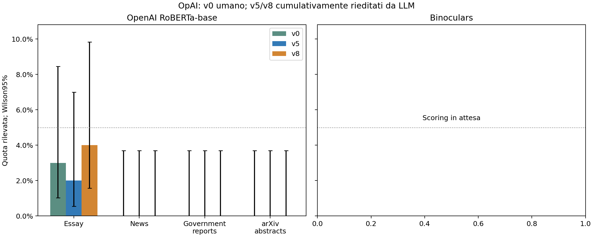

# Obiettivo e stato dell'esperimento

Il pilota misura quanti testi OpAI-Bench vengono riconosciuti come macchina da OpenAI RoBERTa-base e Binoculars, mantenendo le soglie già calibrate su MGTBench. Serve a verificare se un successivo studio di evasione avrebbe un numero sufficiente di originali inizialmente rilevati. **Qui non si applicano humanizer, non si generano testi e non si calcola ASR.**

I testi **v0 sono umani; v5 e v8 sono testi umani rieditati cumulativamente da LLM, non testi generati da zero**. L'analisi è descrittiva e non è validata da annotazioni umane indipendenti. Le etichette v0/v5/v8 identificano stadi del dataset, non una misura umana della quantità o della qualità dell'intervento artificiale.

**Stato: OpenAI completato su tutti i 1.200 testi; Binoculars in attesa di GPU.** Lo scoring OpenAI è stato eseguito qui su CPU in FP32. Questo report è quindi parziale: non riporta rilevazioni o AUROC inventate per Binoculars. Per OpenAI, sia v5 sia v8 **falliscono il criterio di fattibilità**. Il notebook già predisposto permette di completare Binoculars sulle due T4 e riutilizza gli score OpenAI inclusi.

# Piano e campione

`config_pilot.json` è stato committato in **`d0bccd9` prima dello scoring**. Si utilizzano 100 documenti per ciascun dominio: essay, news, government reports e arXiv abstracts. Il totale è **400 documenti e 1.200 testi**. Per ogni documento viene scelta una sola traiettoria completa; v0/v5/v8 appartengono allo stesso editor. Il seme è 42; prima si campionano i documenti, poi si sceglie uniformemente una delle loro traiettorie complete disponibili. La selezione non usa punteggi detector.

L'editor viene salvato anche per v0 come identificativo della traiettoria scelta: non significa che v0 sia stato scritto da quell'editor. Il campione contiene 276 traiettorie Gemini 2.5 Flash, 69 GPT-5.4-nano, 53 GPT-5.4 e 2 Qwen3-8B. Il disegno bilancia i domini, **non gli editor**: disponibilità e versioni complete differiscono fra modelli. Le conclusioni aggregate riguardano questa miscela.

La precedente analisi stilometrica conteneva 188 documenti distinti in 200 traiettorie. L'audit ha individuato altri documenti già usati nell'asimmetria semantica e nelle estensioni: l'unione è di **534 documenti**, tutti esclusi prima del campionamento. Si esclude `document_hash_id`, non soltanto la traiettoria di un editor. I 400 nuovi documenti non hanno sovrapposizioni con questa unione. L'elenco e la provenienza delle esclusioni sono nel piano.

Il dataset è `OpAI-Bench1/OpAI-Bench`, revisione **`072c03c7051409346aaba05168d183cf6d863ee9`**, split `test`, sottoinsieme `main`. Si riusano i Parquet ufficiali verificati del caricatore precedente: il vecchio JSONL era filtrato a v0/v3/v4/v5 e non conteneva v8. Lo schema è stato verificato sui file effettivi: `document_hash_id`, `domain`, `generator`, `version_index`, `text`, `record_id`, `split`, `subset`. Per ogni documento si conservano identità della traiettoria, editor e hash del testo.

La **regola di fattibilità**, fissata prima dei risultati, è una frazione rilevata **almeno pari a un terzo** sul totale dei 400 documenti, separatamente per v5/v8 e per detector. Occorrono quindi almeno **134/400 rilevazioni**. È una regola pratica di avanzamento: non garantisce che un futuro campione da 300 documenti contenga almeno 100 rilevati. Si riportano anche i domini separati, senza aggiungere a posteriori un obbligo che ciascun dominio superi la regola.

# Pipeline e soglie congelate

Si chiamano direttamente le funzioni usate nello studio MGTBench:

- `humanizers.detection.score_detector`;
- `humanizers.zero_shot.score_binoculars`.

Non si introducono pulizie del testo, normalizzazioni, sostituzioni di modello o troncamenti diversi. Gli identificativi completi e le revisioni esatte dei checkpoint sono conservati in `config_pilot.json`.

OpenAI usa RoBERTa-base OpenAI Detector, indice della classe macchina 0 (`Fake`), FP32. Copre tutto il testo con chunk non sovrapposti e media delle probabilità pesata per token. Il budget massimo rimane 512 token inclusi quelli speciali.

Binoculars usa Falcon-7B e Falcon-7B-Instruct alle revisioni dello studio. Rimangono FP16, due dispositivi CUDA distinti e finestre con copertura completa. Il punteggio è il rapporto delle medie globali delle componenti token; valori inferiori indicano maggiore evidenza di testo macchina. Non si quantizzano i modelli per farli entrare in un'altra configurazione.

- OpenAI: rilevato come macchina se score **>0,9706076979637146**.
- Binoculars: rilevato come macchina se rapporto **<0,9046559856180912**.
- Le parità sono classificate come umane. **Nessuna ricalibrazione.**

Per ogni detector/versione/dominio si riporta k/n con intervallo Wilson bilaterale al 95%. Su v0 la frazione è l'FPR di trasferimento. Su v5/v8 si parla di tasso di rilevazione di testi rieditati, senza assumerli equivalenti a generazioni interamente artificiali. AUROC confronta v0 con v5 e v0 con v8; per Binoculars si inverte il segno del rapporto prima del calcolo. Non si applicano test statistici.

# Risultati disponibili

Per OpenAI ogni cella riporta **k/n (percentuale), [Wilson 95%]**. Sul totale dei 400 documenti, v0 ha FPR 0,75% [0,26%; 2,18%]; v5 ha rilevazione 0,50% [0,14%; 1,80%] e v8 1,00% [0,39%; 2,54%].

| Dominio | v0 umano | v5 rieditato | v8 rieditato |
|---|---:|---:|---:|
| Essay | 3/100 (3,0%), [1,03; 8,45]% | 2/100 (2,0%), [0,55; 7,00]% | 4/100 (4,0%), [1,57; 9,84]% |
| News | 0/100, [0; 3,70]% | 0/100, [0; 3,70]% | 0/100, [0; 3,70]% |
| Government reports | 0/100, [0; 3,70]% | 0/100, [0; 3,70]% | 0/100, [0; 3,70]% |
| arXiv abstracts | 0/100, [0; 3,70]% | 0/100, [0; 3,70]% | 0/100, [0; 3,70]% |
| Totale | 3/400 (0,75%), [0,26; 2,18]% | 2/400 (0,50%), [0,14; 1,80]% | 4/400 (1,00%), [0,39; 2,54]% |

**Esito pratico:** con OpenAI e queste soglie, un pannello OpAI non fornisce denominatori sufficienti per l'ASR condizionato. Occorrerebbero almeno 134/400 originali rilevati; se ne osservano 2 per v5 e 4 per v8. Il basso FPR sui v0 non è accompagnato da una capacità utile di rilevare i livelli rieditati. Non si ricalibra la soglia per ottenere un esito più favorevole. La decisione per Binoculars rimane aperta.

La figura rappresenta soltanto score effettivamente calcolati. Un detector in attesa non è rappresentato con un tasso nullo. L’asse verticale parte da zero ed è adattato ai tassi e agli intervalli disponibili; la linea punteggiata indica il riferimento del 5%.

{width=100%}

| Dominio | AUROC v0 contro v5 | AUROC v0 contro v8 |
|---|---:|---:|
| Essay | 0,5502 | 0,6345 |
| News | 0,4685 | 0,4998 |
| Government reports | 0,4874 | 0,4852 |
| arXiv abstracts | 0,5876 | 0,5052 |
| Totale, 400 documenti | 0,5190 | 0,5345 |

Le AUROC complessive sono vicine a 0,5: **la scarsa rilevazione non appare spiegata soltanto da una soglia conservativa**, perché la separazione attraverso l'intera scala degli score è limitata. Essay mostra una separazione numericamente maggiore per v8 (0,6345), ma alla soglia congelata solo quattro testi sono rilevati. Non si applicano test o interpretazioni causali. La miscela di editor e domini limita la generalizzazione; v5/v8 non sono generazioni da zero come gli originali macchina MGTBench.

# Lunghezza e riferimento MGTBench

La mediana di parole usa il conteggio per spazi del testo effettivamente passato ai detector. Le tre versioni appartengono sempre agli stessi 100 documenti del dominio. Le modifiche cumulative comprendono compressione ed espansione: un cambiamento di rilevazione può dipendere anche dalla lunghezza, che qui non si isola causalmente.

| Dominio | v0: mediana parole | v5: mediana parole | v8: mediana parole |
|---|---:|---:|---:|
| arXiv abstracts | 228,0 | 252,5 | 248,5 |
| Essay | 349,5 | 394,0 | 375,5 |
| News | 364,5 | 394,0 | 370,5 |
| Government reports | 567,5 | 640,0 | 623,5 |

I riferimenti storici sono riportati anche in `summary_rates.csv`, con dataset e tipo di tasso distinti:

| Detector | Originali macchina MGTBench | Umana calibrazione MGTBench |
|---|---:|---:|
| OpenAI RoBERTa-base | 71/123 (57,7%) | 15/300 (5,0%) |
| Binoculars | 117/123 (95,1%) | 15/300 (5,0%) |

Il 5% sugli umani di calibrazione deriva dalla costruzione della soglia: **non è una verifica indipendente dell'FPR**. La misura sui nuovi v0 OpAI serve invece a descriverne il trasferimento. MGTBench contiene originali macchina con una diversa costruzione; OpAI contiene umani rieditati. Le percentuali non confrontano la stessa popolazione o lo stesso grado di intervento artificiale. Le righe di calibrazione nel CSV sono etichettate esplicitamente e i loro intervalli non validano l'FPR fuori campione.

# File e completamento

Il branch è **`feature/opai-detectability-pilot`**. I file sono in `results_opai_detectability_pilot/`:

- `config_pilot.json`: piano, soglie, 534 esclusioni e regola di fattibilità;
- `panel.jsonl` e `panel_metadata.csv`: 1.200 testi selezionati e relativi identificativi;
- `selection.json`: hash, revisione, disponibilità per dominio e verifica di assenza di sovrapposizioni;
- `scores_long.csv`: score effettivi per documento/versione/detector; non contiene score inventati per il detector in attesa;
- `summary_rates.csv`: tassi, Wilson, mediane di parole e riferimenti MGTBench;
- `auroc.csv`: separazione v0/v5 e v0/v8 per dominio e complessiva;
- `feasibility.csv`: applicazione della regola di un terzo ai risultati disponibili;
- `detection_rates.png`: grafico con Wilson;
- `experiment.json`: stato, detector completati/in attesa e copertura degli score;
- `scores_<detector>.csv`, `run_<detector>.json` e cache per testo: risultati dettagliati e ripresa;
- questo report in Markdown e PDF.

Lo script è **`scripts/opai_detectability_pilot.py`**, con tre fasi `prepare`, `score`, `summarize`. Per rigenerare il campione servono i Parquet ufficiali del caricatore `scripts/download_opai.py` alla revisione indicata; per lo scoring basta il pannello già incluso nel repository. `summarize` non esegue inferenza e non ricalibra soglie.

Il notebook **`kaggle/OpAI_Detectability_Pilot.ipynb`** richiede Internet e **due T4**, senza Secrets. Include l'ambiente Python senza `ensurepip`, verifica della cache scrivibile con spazio sufficiente per i Falcon, sei celle di codice e ZIP degli output. Le cache persistono dopo ogni testo e permettono la ripresa da un checkpoint caricato negli Input, anche estratto. Il notebook esegue solo i detector mancanti nel proprio run; il pannello rimane congelato. Lo stato finale atteso è `completed`, con **2.400 score**.

Il comando per ricalcolare soltanto le tabelle, dopo lo scoring, è:

```bash
python scripts/opai_detectability_pilot.py --stage summarize
```

Le verifiche del codice coprono soglie e parità, orientamento dell'AUROC, intervalli con zero eventi, mancata copertura dei documenti, integrità dei testi e distinzione fra detector in attesa e zero rilevazioni. Sono verifiche software, non annotazioni umane o validazione scientifica del detector.
