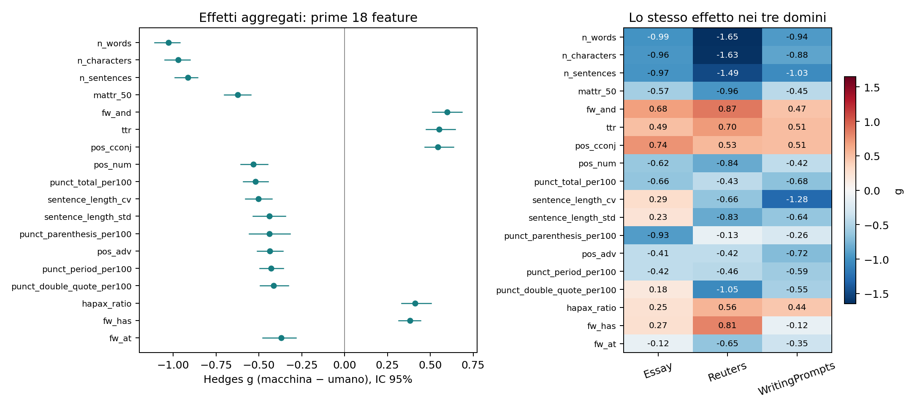
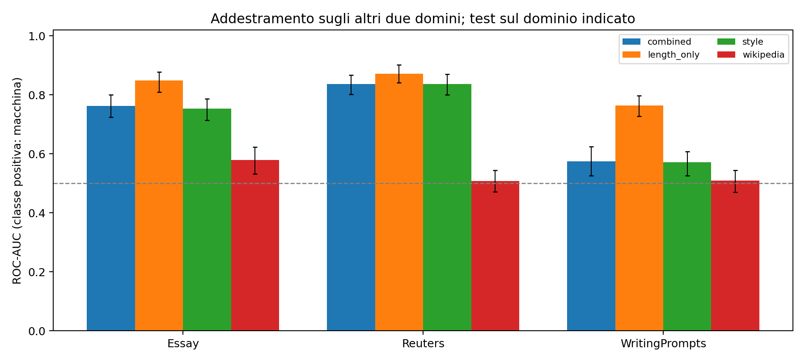

# Esperimento esplorativo: componente stilometrica

> Aggiornamento successivo: i tre CSV forniti dall’autore come scaricati da Google Drive sono identici byte per byte ai file usati; vedere il [confronto di provenienza](../provenance/mgtbench_drive_comparison.md). Gli avvisi sottostanti descrivono lo stato della verifica al momento del run; i risultati e i manifest non sono stati ricalcolati.

## Dati e provenienza

Testi analizzati: 1800; coppie di origine: 900. Etichetta 0 = umano, 1 = macchina. Ogni umano compare una volta nel campione principale.

La provenienza completa, gli hash SHA-256 e i conteggi di esclusione sono in `data_manifest.json`. Il campione usa la baseline MGTBench, senza attacchi o riscritture. Non è una riproduzione dei file di attacco chiamati `clean` in TH-Bench.

| domain | generator | label | n |
| --- | --- | --- | --- |
| Essay | ChatGLM | 1 | 43 |
| Essay | ChatGPT | 1 | 43 |
| Essay | ChatGPT-turbo | 1 | 43 |
| Essay | Claude | 1 | 43 |
| Essay | Dolly | 1 | 43 |
| Essay | GPT4All | 1 | 43 |
| Essay | StableLM | 1 | 42 |
| Essay | human | 0 | 300 |
| Reuters | ChatGLM | 1 | 43 |
| Reuters | ChatGPT | 1 | 43 |
| Reuters | ChatGPT-turbo | 1 | 43 |
| Reuters | Claude | 1 | 43 |
| Reuters | Dolly | 1 | 43 |
| Reuters | GPT4All | 1 | 43 |
| Reuters | StableLM | 1 | 42 |
| Reuters | human | 0 | 300 |
| WritingPrompts | ChatGLM | 1 | 43 |
| WritingPrompts | ChatGPT | 1 | 43 |
| WritingPrompts | ChatGPT-turbo | 1 | 43 |
| WritingPrompts | Claude | 1 | 43 |
| WritingPrompts | Dolly | 1 | 43 |
| WritingPrompts | GPT4All | 1 | 43 |
| WritingPrompts | StableLM | 1 | 42 |
| WritingPrompts | human | 0 | 300 |

## Protocollo

Feature fissate prima di osservare i risultati: spaCy en_core_web_sm 3.8.0, textstat en_US e MATTR con finestra 50. Le definizioni e i denominatori sono in `feature_schema.json`. I testi non vengono troncati. TTR, hapax e conteggi globali sono diagnostici esclusi dal modello principale di stile.

Effetti: Hedges g corretto per piccoli campioni, con segno macchina meno umano; g positivo indica valori maggiori nei testi macchina. IC 95% bootstrap a gruppi di origine; p-value paired t sulle differenze entro coppia e correzione BH separata entro ogni tabella. Per generatore si confrontano soltanto gli umani delle corrispondenti coppie. Le soglie di grandezza dell’effetto sono euristiche, non confini naturali.

Classificatore: regressione logistica L2, C=1 fisso, class_weight=balanced, soglia 0.5; imputazione mediana e standardizzazione stimate esclusivamente sul training. CV a cinque fold con gruppi di origine disgiunti entro dominio; leave-one-domain-out; leave-one-generator-out con ulteriore esclusione dal training dei gruppi sorgente nel test. Nessun tuning sul test. Le metriche usano predizioni out-of-fold aggregate. Gli IC delle metriche ricampionano le predizioni fisse per gruppo: non includono tutta l’incertezza dell’addestramento.

## Feature con i maggiori effetti aggregati

| feature | human_mean | machine_mean | hedges_g | ci_low | ci_high | bh_q |
| --- | --- | --- | --- | --- | --- | --- |
| n_words | 536.323 | 255.546 | -1.027 | -1.109 | -0.961 | 0.000 |
| n_characters | 3271.951 | 1591.097 | -0.971 | -1.049 | -0.903 | 0.000 |
| n_sentences | 31.036 | 14.153 | -0.914 | -0.989 | -0.857 | 0.000 |
| mattr_50 | 0.809 | 0.782 | -0.624 | -0.701 | -0.546 | 0.000 |
| fw_and | 0.026 | 0.035 | 0.598 | 0.512 | 0.684 | 0.000 |
| ttr | 0.505 | 0.551 | 0.551 | 0.475 | 0.646 | 0.000 |
| pos_cconj | 0.033 | 0.041 | 0.545 | 0.467 | 0.635 | 0.000 |
| pos_num | 0.021 | 0.011 | -0.533 | -0.607 | -0.448 | 0.000 |
| punct_total_per100 | 16.395 | 13.367 | -0.519 | -0.591 | -0.446 | 0.000 |
| sentence_length_cv | 0.443 | 0.364 | -0.503 | -0.578 | -0.423 | 0.000 |
| sentence_length_std | 7.915 | 6.761 | -0.438 | -0.534 | -0.344 | 0.000 |
| punct_parenthesis_per100 | 0.816 | 0.314 | -0.437 | -0.557 | -0.318 | 0.000 |
| pos_adv | 0.042 | 0.034 | -0.437 | -0.511 | -0.359 | 0.000 |
| punct_period_per100 | 6.623 | 5.567 | -0.428 | -0.495 | -0.358 | 0.000 |
| punct_double_quote_per100 | 2.052 | 0.999 | -0.413 | -0.492 | -0.328 | 0.000 |
| hapax_ratio | 0.356 | 0.392 | 0.412 | 0.333 | 0.504 | 0.000 |
| fw_has | 0.003 | 0.005 | 0.381 | 0.315 | 0.444 | 0.000 |
| fw_at | 0.005 | 0.003 | -0.369 | -0.478 | -0.283 | 0.000 |

Gli effetti aggregati non dimostrano robustezza: consultare `feature_effects.csv` per tutti i domini, generatori e incroci dominio×generatore.

## Classificazione e trasferimento

| protocol | domain | generator | feature_set | n_test | roc_auc | roc_auc_ci_low | roc_auc_ci_high | balanced_accuracy | macro_f1 |
| --- | --- | --- | --- | --- | --- | --- | --- | --- | --- |
| leave_domain_out | Essay | ALL | combined | 600 | 0.762 | 0.725 | 0.800 | 0.543 | 0.453 |
| leave_domain_out | Essay | ALL | length_only | 600 | 0.848 | 0.810 | 0.878 | 0.657 | 0.654 |
| leave_domain_out | Essay | ALL | style | 600 | 0.754 | 0.714 | 0.788 | 0.550 | 0.464 |
| leave_domain_out | Essay | ALL | wikipedia | 600 | 0.579 | 0.532 | 0.624 | 0.523 | 0.519 |
| leave_domain_out | Reuters | ALL | combined | 600 | 0.837 | 0.802 | 0.867 | 0.788 | 0.786 |
| leave_domain_out | Reuters | ALL | length_only | 600 | 0.872 | 0.841 | 0.901 | 0.755 | 0.751 |
| leave_domain_out | Reuters | ALL | style | 600 | 0.837 | 0.800 | 0.870 | 0.775 | 0.774 |
| leave_domain_out | Reuters | ALL | wikipedia | 600 | 0.507 | 0.472 | 0.545 | 0.562 | 0.498 |
| leave_domain_out | WritingPrompts | ALL | combined | 600 | 0.575 | 0.527 | 0.625 | 0.548 | 0.539 |
| leave_domain_out | WritingPrompts | ALL | length_only | 600 | 0.764 | 0.728 | 0.798 | 0.708 | 0.705 |
| leave_domain_out | WritingPrompts | ALL | style | 600 | 0.572 | 0.527 | 0.609 | 0.538 | 0.529 |
| leave_domain_out | WritingPrompts | ALL | wikipedia | 600 | 0.509 | 0.471 | 0.545 | 0.515 | 0.429 |
| leave_generator_out | ALL | ChatGLM | combined | 258 | 0.966 | 0.943 | 0.986 | 0.907 | 0.907 |
| leave_generator_out | ALL | ChatGLM | length_only | 258 | 0.948 | 0.912 | 0.982 | 0.829 | 0.824 |
| leave_generator_out | ALL | ChatGLM | style | 258 | 0.968 | 0.943 | 0.988 | 0.915 | 0.914 |
| leave_generator_out | ALL | ChatGLM | wikipedia | 258 | 0.456 | 0.388 | 0.521 | 0.450 | 0.373 |
| leave_generator_out | ALL | ChatGPT | combined | 258 | 0.949 | 0.923 | 0.971 | 0.891 | 0.891 |
| leave_generator_out | ALL | ChatGPT | length_only | 258 | 0.936 | 0.902 | 0.969 | 0.826 | 0.820 |
| leave_generator_out | ALL | ChatGPT | style | 258 | 0.953 | 0.928 | 0.975 | 0.876 | 0.876 |
| leave_generator_out | ALL | ChatGPT | wikipedia | 258 | 0.438 | 0.383 | 0.497 | 0.500 | 0.439 |
| leave_generator_out | ALL | ChatGPT-turbo | combined | 258 | 0.888 | 0.846 | 0.925 | 0.806 | 0.806 |
| leave_generator_out | ALL | ChatGPT-turbo | length_only | 258 | 0.443 | 0.387 | 0.499 | 0.446 | 0.382 |
| leave_generator_out | ALL | ChatGPT-turbo | style | 258 | 0.880 | 0.837 | 0.924 | 0.814 | 0.814 |
| leave_generator_out | ALL | ChatGPT-turbo | wikipedia | 258 | 0.771 | 0.708 | 0.824 | 0.752 | 0.751 |
| leave_generator_out | ALL | Claude | combined | 258 | 0.726 | 0.666 | 0.788 | 0.659 | 0.644 |
| leave_generator_out | ALL | Claude | length_only | 258 | 0.581 | 0.503 | 0.652 | 0.453 | 0.414 |
| leave_generator_out | ALL | Claude | style | 258 | 0.715 | 0.652 | 0.777 | 0.647 | 0.632 |
| leave_generator_out | ALL | Claude | wikipedia | 258 | 0.553 | 0.490 | 0.619 | 0.624 | 0.603 |
| leave_generator_out | ALL | Dolly | combined | 258 | 0.839 | 0.788 | 0.883 | 0.810 | 0.809 |
| leave_generator_out | ALL | Dolly | length_only | 258 | 0.967 | 0.941 | 0.986 | 0.853 | 0.849 |
| leave_generator_out | ALL | Dolly | style | 258 | 0.848 | 0.798 | 0.895 | 0.802 | 0.802 |
| leave_generator_out | ALL | Dolly | wikipedia | 258 | 0.380 | 0.333 | 0.433 | 0.473 | 0.371 |
| leave_generator_out | ALL | GPT4All | combined | 258 | 0.933 | 0.902 | 0.962 | 0.864 | 0.864 |
| leave_generator_out | ALL | GPT4All | length_only | 258 | 0.946 | 0.914 | 0.973 | 0.798 | 0.790 |
| leave_generator_out | ALL | GPT4All | style | 258 | 0.940 | 0.904 | 0.968 | 0.880 | 0.880 |
| leave_generator_out | ALL | GPT4All | wikipedia | 258 | 0.516 | 0.452 | 0.577 | 0.523 | 0.482 |
| leave_generator_out | ALL | StableLM | combined | 252 | 0.661 | 0.595 | 0.721 | 0.639 | 0.619 |
| leave_generator_out | ALL | StableLM | length_only | 252 | 0.940 | 0.908 | 0.969 | 0.837 | 0.833 |
| leave_generator_out | ALL | StableLM | style | 252 | 0.661 | 0.592 | 0.725 | 0.635 | 0.619 |
| leave_generator_out | ALL | StableLM | wikipedia | 252 | 0.406 | 0.345 | 0.468 | 0.437 | 0.326 |
| within_domain | Essay | ALL | combined | 600 | 0.928 | 0.907 | 0.949 | 0.870 | 0.870 |
| within_domain | Essay | ALL | length_only | 600 | 0.846 | 0.812 | 0.875 | 0.658 | 0.655 |
| within_domain | Essay | ALL | style | 600 | 0.932 | 0.913 | 0.952 | 0.867 | 0.867 |
| within_domain | Essay | ALL | wikipedia | 600 | 0.566 | 0.521 | 0.613 | 0.598 | 0.591 |
| within_domain | Reuters | ALL | combined | 600 | 0.937 | 0.916 | 0.957 | 0.895 | 0.895 |
| within_domain | Reuters | ALL | length_only | 600 | 0.869 | 0.837 | 0.899 | 0.783 | 0.783 |
| within_domain | Reuters | ALL | style | 600 | 0.938 | 0.916 | 0.957 | 0.897 | 0.897 |
| within_domain | Reuters | ALL | wikipedia | 600 | 0.633 | 0.600 | 0.668 | 0.580 | 0.513 |
| within_domain | WritingPrompts | ALL | combined | 600 | 0.888 | 0.858 | 0.913 | 0.827 | 0.827 |
| within_domain | WritingPrompts | ALL | length_only | 600 | 0.803 | 0.771 | 0.831 | 0.738 | 0.735 |
| within_domain | WritingPrompts | ALL | style | 600 | 0.888 | 0.859 | 0.913 | 0.833 | 0.833 |
| within_domain | WritingPrompts | ALL | wikipedia | 600 | 0.583 | 0.548 | 0.623 | 0.533 | 0.495 |

## Lista corta esplorativa

Regola: stessa direzione in tutti e tre i domini, |g| ≥ 0.3 in ciascuno, segno coerente in almeno 5/7 dei generatori; massimo 12 feature; rimozione di ridondanze con |correlazione di Spearman| ≥ 0.85. La lista è ricavata dall’intero campione ed è una proposta per esperimenti successivi: non è stata retroattivamente valutata come se fosse una scelta indipendente dal test.

| feature | pooled_g | min_domain_abs_g | generators_passing | n_generators |
| --- | --- | --- | --- | --- |
| fw_and | 0.598 | 0.465 | 7 | 7 |
| punct_total_per100 | -0.519 | 0.431 | 7 | 7 |
| pos_num | -0.533 | 0.415 | 7 | 7 |
| pos_adv | -0.437 | 0.414 | 7 | 7 |
| mattr_50 | -0.624 | 0.449 | 5 | 7 |
| punct_period_per100 | -0.428 | 0.421 | 6 | 7 |
| pos_noun | 0.346 | 0.395 | 6 | 7 |

## Cosa si può concludere sulla guida Wikipedia

Il modello `wikipedia` usa soltanto i proxy fissati nel codice: vocabolario AI, enfasi, conclusioni, formule conversazionali, parallelismi negativi, Markdown ed em dash. Non misura l’intera guida, né verifica superficialità, neutralità, correttezza delle fonti o intenzione dell’autore. Confrontare `wikipedia` con `style` e `combined` su dati non visti; un vantaggio solo nel dominio di addestramento non dimostra trasferibilità. Gli indicatori possono essere rari, dipendere dall’epoca dei generatori e cambiare segno.

## Limiti

- Circa 42–43 testi macchina per generatore e dominio: le stime fini hanno incertezza elevata.
- Le feature normalizzate possono ancora dipendere dalla lunghezza; `length_only` è un controllo, non elimina ogni confondente.
- I generatori MGTBench sono storici: risultati non generalizzabili automaticamente agli LLM attuali o a testi umanizzati.
- La lista corta richiede conferma indipendente, idealmente su un nuovo campione e nuove riscritture.
- Il mirror pubblico, se utilizzato, non è stato confrontato byte per byte con l’archivio originale Google Drive; vedere manifest.

File completi: `feature_effects.csv`, `feature_robustness.csv`, `classifier_metrics.csv`, `predictions.csv`, `run_metadata.json`, `feature_schema.json` e `data_manifest.json`.
