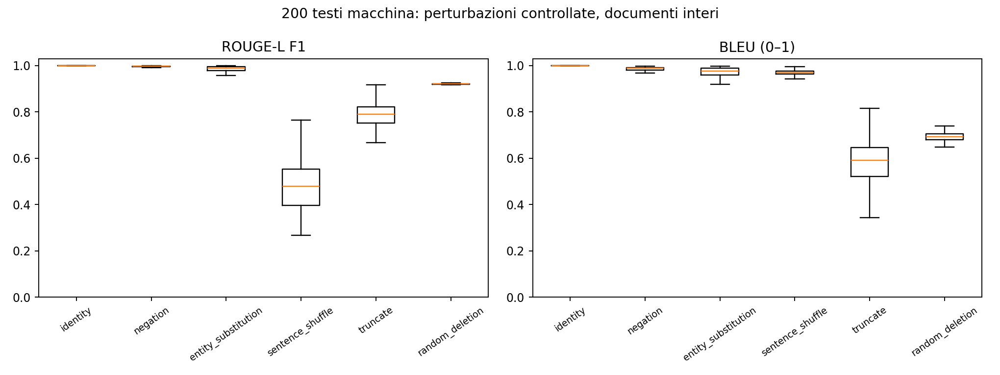

# Esperimento semantico: risultati eseguiti e stadi pendenti

Testi macchina originali: **200**; seed 42. Campione selezionato tra i testi idonei a tutte le trasformazioni, bilanciando dominio e generatore per quanto consentito dagli idonei. Questa selezione introduce un bias esplicito: le frasi ambigue o senza entità non vengono rappresentate. Le trasformazioni non applicabili sono contate, non sostituite con identità; vedere `eligibility_manifest.json`.

| perturbazione | applicate | saltate |
| --- | --- | --- |
| identity | 200 | 0 |
| negation | 200 | 0 |
| entity_substitution | 200 | 0 |
| sentence_shuffle | 200 | 0 |
| truncate | 200 | 0 |
| random_deletion | 200 | 0 |

## Metriche effettivamente eseguite

| stage | n_pairs | elapsed_seconds | peak_rss_mib |
| --- | --- | --- | --- |
| lexical | 1607 | 33.789 | 221.945 |

| perturbation | metric | n_pairs | mean | ci_low | ci_high |
| --- | --- | --- | --- | --- | --- |
| entity_substitution | lexical_rouge_l_f1 | 200 | 0.984 | 0.982 | 0.986 |
| entity_substitution | lexical_bleu | 200 | 0.968 | 0.963 | 0.972 |
| identity | lexical_rouge_l_f1 | 200 | 1.000 | 1.000 | 1.000 |
| identity | lexical_bleu | 200 | 1.000 | 1.000 | 1.000 |
| negation | lexical_rouge_l_f1 | 200 | 0.996 | 0.995 | 0.996 |
| negation | lexical_bleu | 200 | 0.985 | 0.983 | 0.986 |
| random_deletion | lexical_rouge_l_f1 | 200 | 0.921 | 0.921 | 0.921 |
| random_deletion | lexical_bleu | 200 | 0.693 | 0.691 | 0.696 |
| sentence_shuffle | lexical_rouge_l_f1 | 200 | 0.492 | 0.477 | 0.509 |
| sentence_shuffle | lexical_bleu | 200 | 0.968 | 0.966 | 0.969 |
| truncate | lexical_rouge_l_f1 | 200 | 0.781 | 0.770 | 0.790 |
| truncate | lexical_bleu | 200 | 0.576 | 0.560 | 0.592 |

Gli IC 95% ricampionano i documenti sorgente (1.000 bootstrap), assegnando uguale peso a ciascuna fonte. Non descrivono l’incertezza della correttezza semantica delle perturbazioni. `paired_identity_deltas.csv` confronta ogni trasformazione con l’identità della stessa sorgente; i confronti locali usano l’esatta frase target contro se stessa.

## Stadi non eseguiti

| stage | reason |
| --- | --- |
| embedding | Pretrained model files unavailable; metrics NOT computed |
| bertscore | Pretrained model files unavailable; metrics NOT computed |
| nli | Pretrained model files unavailable; metrics NOT computed |

**OpAI-Bench:** {"status": "unrun", "reason": "Official OpAI-Bench files absent; Hugging Face access is required. No substitute data used."}

Le celle neurali mancanti non sono stime e non sono state riempite con valori attesi. Finché embedding, BERTScore e NLI non vengono eseguiti, l’ipotesi «coseno/BERTScore alti, NLI basso con negazione» resta non verificata.

## Definizioni e interpretazione

- ROUGE-L F1 usa stemming Porter; BLEU è SacreBLEU 13a, smoothing esponenziale, effective_order=True, una reference, scala0–1. Le versioni locali sono sulle frasi effettivamente modificate.
- Coseno: medie normalizzate e pesate per token delle rappresentazioni di frasi/chunk MiniLM, senza troncamento del documento.
- BERTScore locale: RoBERTa-base layer10, IDF=False, rescale_with_baseline=False. Per documenti lunghi si usa una distinta approssimazione con matching di chunk, non il BERTScore integrale troncato.
- NLI: DeBERTa-v3-base addestrato su MNLI/FEVER/ANLI. Forward significa originale→modificato; reverse modificato→originale. La mappa delle etichette viene letta dal config. Le probabilità non sono una prova logica.
- Per ogni frase/chunk ipotesi si recuperano fino a3 candidati e si conserva il supporto massimo. Si riportano media, minimo, q10, quota sotto0.5 e contraddizione; il massimo può sovrastimare il supporto e il retrieval può perdere evidenza distribuita. I target locali evitano retrieval e diluizione.
- Negazione: alterazione intenzionale, non gold contradiction verificata per tutti i casi. Entity swap: contenuto alterato o non supportato, non necessariamente contraddittorio. Troncamento e omissione: spesso neutralità nella direzione che richiede informazione persa.
- Shuffle conserva le proposizioni: un NLI aggregato per frase può legittimamente restare alto. Questo test segnala il limite rispetto a coerenza e ordine narrativo.
- Le versioni OpAI sono cumulative: confronti principali v3→v4 Compress e v4→v5 Expand; v0→v4/v5 sono secondari. Le espansioni senza nuove informazioni possono essere entailed in entrambe le direzioni.

## Ripresa

Scaricare modelli e dati con i comandi del README dopo aver autorizzato i domini nella configurazione. Eseguire gli stadi mancanti e poi `--stage report`, senza rigenerare il campione. Ogni stadio gira in un processo separato; peak RSS viene registrato. Il limite4GiB non è dichiarato verificato per modelli mai eseguiti.

File completi: `scores.csv`, `metric_summary.csv`, `directional_deltas.csv`, `preparation_manifest.json`, `*_run.json`. I testi delle coppie e i metadati esatti delle modifiche restano nei file locali ignorati `data/semantic/`.
