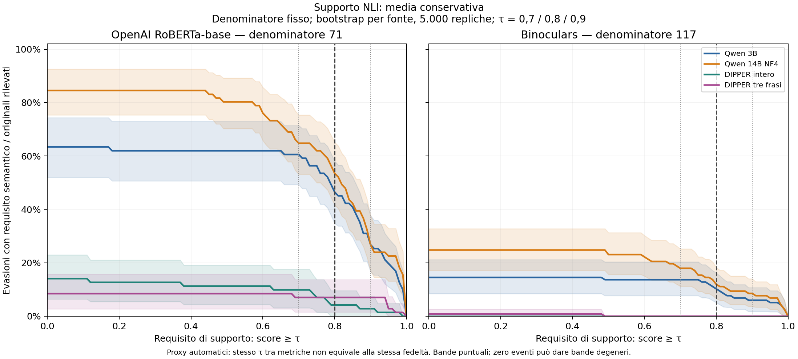
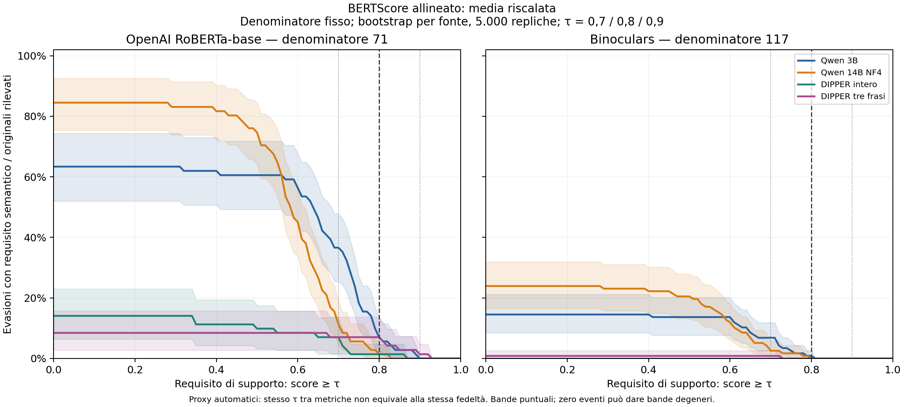

**Risultato principale.** Una parte delle riscritture evade il detector e supera anche i requisiti NLI fissati per questa analisi. La quota dipende però dal metodo, dal detector e dalla definizione di supporto semantico. Su OpenAI RoBERTa-base, Qwen 14B passa da **60/71 evasioni semplici** a **38/71 moderate** e **18/71 stringenti**; Qwen 3B passa da **45/71** a **33/71** e **18/71**. Il vantaggio iniziale del 14B scompare dunque nel conteggio stringente. Su Binoculars i corrispondenti conteggi stringenti sono **10/117** e **7/117**. Cambiando proxy e usando BERTScore riscalato, le curve e l'ordine numerico cambiano molto.

Questo risultato descrive **quanta evasione soddisfa requisiti automatici aggiuntivi**. Non quantifica una percentuale di significato perso. Nel confronto diretto fra evasi e non evasi, tutti gli intervalli delle differenze NLI con almeno due evasi comprendono zero: questi dati non stabiliscono che l'evasione sia accompagnata da una fedeltà inferiore, né dimostrano equivalenza fra i due gruppi.

# 1. Domanda e campione

La domanda è: **quanta evasione rimane se si richiede anche un buon supporto semantico della riscrittura?** Finora evasione e semantica erano descritte separatamente. Qui si collegano le decisioni dei detector e i punteggi semantici riferiti esattamente allo stesso testo riscritto.

Ogni *fonte* è un testo macchina originale di MGTBench. Si usano le **123 fonti comuni** con tutti e quattro gli output validi: 41 Essay, 41 Reuters e 41 WritingPrompts. Ogni fonte produce quattro riscritture, per un totale di **492 coppie originale–riscrittura**. Applicando due detector si ottengono **984 righe**, una per fonte, metodo e detector.

I metodi sono **Qwen2.5-3B-Instruct in FP16**, **Qwen2.5-14B-Instruct in NF4**, **DIPPER XXL sull'intero passaggio** e **DIPPER XXL a gruppi di tre frasi con contesto cumulativo**. Quest'ultimo riscrive gruppi successivi: non applica tre volte DIPPER allo stesso testo. I nomi abbreviati nelle tabelle identificano queste configurazioni, non tutte le possibili configurazioni delle famiglie di modelli.

Sono incluse anche le riscritture più lunghe dell'originale. Sul campione comune gli allungamenti sono 25 per Qwen 3B, 17 per Qwen 14B, 4 per DIPPER intero e 17 per DIPPER tre frasi. Il rapporto di lunghezza è il numero di parole della riscrittura diviso per quello dell'originale; non viene usato per escludere casi.

Il campione comune deriva dallo studio su 126 fonti. Tre fonti sono escluse perché non hanno tutti e quattro gli output validi; contengono quattro generazioni incomplete. Questa selezione delle riscritture riuscite può rendere i risultati semantici più favorevoli di quelli relativi a tutti i tentativi. L'esperimento è **retrospettivo e descrittivo**.

# 2. Definizioni fissate prima del calcolo

Le definizioni sono salvate in **`config_exp3.json`**, nel commit **`efb7d32`**, prima del calcolo di questa analisi. Le distribuzioni NLI e gli ASR precedenti erano però già stati esaminati. Le soglie seguenti **non sono cieche o preregistrate** e non costituiscono soglie validate di correttezza semantica umana.

**Evasione semplice.** L'originale è classificato come macchina e la sua riscrittura come umana. Un originale già classificato come umano non è un'evasione della riscrittura e non entra nel denominatore dell'ASR.

**Evasione moderata.** È un'evasione semplice e la **media NLI conservativa è almeno 0,8**.

**Evasione stringente.** È un'evasione semplice, la media conservativa è almeno 0,8 e il **minimo NLI bidirezionale è almeno 0,5**.

Il valutatore NLI finale usa DeBERTa-v3 base addestrato su NLI, con finestre di una o due frasi/chunk come premesse. Ogni unità dell'altro testo cerca la premessa che la supporta maggiormente. Il procedimento è eseguito nelle due direzioni. *Forward* cerca supporto alle affermazioni riscritte nell'originale; *reverse* cerca supporto alle informazioni originali nella riscrittura. La **media conservativa** è il minore fra media forward e media reverse. Il **minimo bidirezionale** è il più basso fra tutti i supporti nelle due direzioni. Non si confrontano documenti interi troncati.

Se $n_D$ è il numero di originali rilevati dal detector e $E_i$ indica un'evasione, la curva principale è:

$$
ASR(\tau)=\frac{\sum_i E_i\,\mathbf{1}(\mathrm{mediaNLI}_i\geq\tau)}{n_D}.
$$

**Il denominatore rimane identico** per ASR semplice, moderata, stringente e per tutti i punti della curva: tutti gli originali rilevati del campione comune. Non si divide per il solo sottoinsieme che supera il requisito semantico. Per costruzione ASR stringente ≤ ASR moderata ≤ ASR semplice.

La griglia comprende 101 valori, da 0 a 1 con passo 0,01; si riportano esplicitamente 0,7, 0,8 e 0,9. Nel CSV è disponibile anche l'intera curva con il vincolo aggiuntivo minimo ≥0,5. La soglia storica 0,04075 non è usata per definire l'esito di questo esperimento.

La stessa analisi di curva viene ripetuta con la **media bidirezionale conservativa di BERTScore F1 allineato e riscalato**, colonna `bs_resc_mean`. Si riutilizza l'allineamento delle unità, con RoBERTa-base layer 10 e baseline inglese 0,814463. La riscalatura è `(F1 − baseline)/(1 − baseline)`; valori negativi sono possibili e non vengono tagliati. Non si usa il BERTScore documentale grezzo del catalogo. **Lo stesso valore numerico di τ non equivale allo stesso requisito di fedeltà nelle due metriche**; differiscono inoltre le premesse/allineamenti utilizzati. Il confronto è una sensibilità al proxy, non una calibrazione semantica comune.

# 3. Join, detector e controllo dell'ASR iniziale

La tabella semantica comune viene collegata ai risultati detector attraverso fonte, metodo e identificativo della riscrittura. Si verificano anche hash dei testi, metadati, lunghezze, unicità delle righe e completezza dei quattro metodi sulle stesse fonti. BERTScore riscalato e rapporto di lunghezza vengono integrati dal catalogo completo, poiché la tabella comune delle correlazioni non li conteneva.

Le soglie dei detector sono quelle già calibrate su **300 gruppi umani separati dal test**, con FPR obiettivo 5%. Non vengono ricalibrate sulle riscritture:

- **OpenAI RoBERTa-base:** macchina se score > 0,9706076979637146;
- **Binoculars:** macchina se rapporto grezzo < 0,9046559856180912. Il rapporto non è una probabilità e valori più bassi indicano maggiore evidenza di testo macchina.

I casi esattamente sulla soglia sono classificati come umani. Il 5% è l'obiettivo di calibrazione: questo esperimento non stima nuovamente l'FPR su umani di test.

Prima dei confronti semantici, l'ASR ottenuto dal join è confrontato riga per riga con i punteggi detector appaiati già salvati. **Tutte le otto combinazioni coincidono**. OpenAI rileva **71/123 originali**, Binoculars **117/123**. I conteggi di evasione semplice sono 45, 60, 10 e 6 per OpenAI; 17, 29, 0 e 1 per Binoculars. `baseline_asr_check.csv` conserva la verifica.

I confronti precedenti sul pannello completo da 126 fonti o sui pilot hanno denominatori diversi. I valori qui riportati coincidono con il precedente **sottoinsieme comune da 123**, non vanno sostituiti a percentuali calcolate su altri campioni senza indicarlo.

# 4. Quanta evasione supera i requisiti NLI?

Ogni cella riporta **k/n (percentuale)**. L'ultima colonna conta, fra le evasioni semplici, quelle avvenute con una riscrittura più lunga dell'originale. Tutte le colonne ASR mantengono il medesimo denominatore del detector.

| Detector e metodo | Semplice | Moderata | Stringente | Evase più lunghe |
|---|---:|---:|---:|---:|
| OpenAI — Qwen 3B | 45/71 (63,4%) | 33/71 (46,5%) | 18/71 (25,4%) | 6 |
| OpenAI — Qwen 14B NF4 | 60/71 (84,5%) | 38/71 (53,5%) | 18/71 (25,4%) | 6 |
| OpenAI — DIPPER intero | 10/71 (14,1%) | 3/71 (4,2%) | 1/71 (1,4%) | 0 |
| OpenAI — DIPPER tre frasi | 6/71 (8,5%) | 5/71 (7,0%) | 3/71 (4,2%) | 1 |
| Binoculars — Qwen 3B | 17/117 (14,5%) | 12/117 (10,3%) | 7/117 (6,0%) | 4 |
| Binoculars — Qwen 14B NF4 | 29/117 (24,8%) | 14/117 (12,0%) | 10/117 (8,5%) | 2 |
| Binoculars — DIPPER intero | 0/117 (0,0%) | 0/117 (0,0%) | 0/117 (0,0%) | 0 |
| Binoculars — DIPPER tre frasi | 1/117 (0,9%) | 0/117 (0,0%) | 0/117 (0,0%) | 0 |

Gli intervalli **Wilson bilaterali al 95%**, espressi in percentuale, sono:

| Detector e metodo | Semplice: IC 95% | Moderata: IC 95% | Stringente: IC 95% |
|---|---:|---:|---:|
| OpenAI — Qwen 3B | [51,8; 73,6] | [35,4; 58,0] | [16,7; 36,6] |
| OpenAI — Qwen 14B NF4 | [74,3; 91,1] | [42,0; 64,6] | [16,7; 36,6] |
| OpenAI — DIPPER intero | [7,8; 24,0] | [1,4; 11,7] | [0,2; 7,6] |
| OpenAI — DIPPER tre frasi | [3,9; 17,2] | [3,0; 15,4] | [1,4; 11,7] |
| Binoculars — Qwen 3B | [9,3; 22,0] | [6,0; 17,1] | [2,9; 11,8] |
| Binoculars — Qwen 14B NF4 | [17,8; 33,3] | [7,3; 19,1] | [4,7; 15,0] |
| Binoculars — DIPPER intero | [0,0; 3,2] | [0,0; 3,2] | [0,0; 3,2] |
| Binoculars — DIPPER tre frasi | [0,2; 4,7] | [0,0; 3,2] | [0,0; 3,2] |

Zero evasioni osservate non significa assenza di incertezza: per **0/117** l'estremo superiore Wilson è **3,18%**, non zero. I valori completi sono in `main_results.csv`.

Su OpenAI, il requisito stringente lascia 18 delle 45 evasioni di Qwen 3B e 18 delle 60 del 14B: rispettivamente il 40% e il 30% delle evasioni semplici. Queste percentuali usano le sole evasioni come denominatore e **non sono gli ASR della tabella**. I 18 successi non riguardano le stesse fonti: 7 sono condivisi, 11 sono esclusivi di ciascuno dei due metodi. La parità dei conteggi non dimostra equivalenza dei sistemi.

DIPPER intero ha più evasioni semplici di DIPPER tre frasi su OpenAI, ma ne conserva meno sotto entrambe le definizioni NLI. Sono conteggi piccoli: 1 contro 3 nella definizione stringente. Su Binoculars l'unica evasione di DIPPER tre frasi non supera il requisito moderato; DIPPER intero non ha evasioni da analizzare.

# 5. Curve complete e sensibilità alla metrica

Le bande delle due figure sono ottenute con **5.000 ricampionamenti per fonte, seme 42**. Ogni estrazione seleziona 123 fonti con ripetizione e mantiene insieme tutti e quattro i metodi e i due detector. Non si ricampionano le 984 righe come osservazioni indipendenti. In ogni replica il denominatore è il numero degli originali rilevati fra le fonti estratte: resta condiviso fra i metodi dello stesso detector.

Le bande sono intervalli percentili **puntuali** al 95%, non bande simultanee sull'intera curva. Quando nessun successo è osservato, il bootstrap empirico può produrre [0; 0]: è un limite del ricampionamento, non certezza di un tasso nullo. Per le singole proporzioni sono disponibili anche gli intervalli Wilson nei CSV.

{width=100%}

{width=100%}

La tabella seguente rende espliciti i punti 0,7, 0,8 e 0,9. Ogni cella contiene **tre conteggi k**, nell'ordine **0,7 / 0,8 / 0,9**. Il denominatore è 71 per OpenAI e 117 per Binoculars, identico per le due metriche.

| Detector e metodo | Media NLI ≥τ: k | Media BERTScore riscalata ≥τ: k |
|---|---:|---:|
| OpenAI — Qwen 3B | 43 / 33 / 19 | 26 / 5 / 0 |
| OpenAI — Qwen 14B NF4 | 46 / 38 / 19 | 8 / 1 / 0 |
| OpenAI — DIPPER intero | 7 / 3 / 2 | 5 / 1 / 0 |
| OpenAI — DIPPER tre frasi | 5 / 5 / 5 | 5 / 5 / 1 |
| Binoculars — Qwen 3B | 16 / 12 / 7 | 8 / 1 / 0 |
| Binoculars — Qwen 14B NF4 | 21 / 14 / 10 | 3 / 0 / 0 |
| Binoculars — DIPPER intero | 0 / 0 / 0 | 0 / 0 / 0 |
| Binoculars — DIPPER tre frasi | 0 / 0 / 0 | 1 / 0 / 0 |

Le curve NLI dei due Qwen su OpenAI scendono sensibilmente fra 0,7 e 0,9: non restano vicine all'ASR semplice fino a requisiti elevati. Per Qwen 14B su Binoculars, 29 evasioni semplici diventano 14 con media NLI ≥0,8 e 10 a 0,9. Le riscritture con buon supporto automatico non scompaiono, ma i conteggi si riducono.

**La conclusione quantitativa è sensibile al proxy.** A 0,8 BERTScore lascia 5 evasioni di Qwen 3B e 1 del 14B su OpenAI, contro 33 e 38 con la media NLI. DIPPER tre frasi ne mantiene 5 con entrambe. Cambia anche l'ordine numerico dei metodi. Questo impedisce di presentare un'unica percentuale di evasione “semanticamente corretta” come risultato indipendente dalla metrica. Non dimostra che BERTScore sia migliore o peggiore: la stessa soglia numerica non ha la stessa calibrazione e l'allineamento non usa le stesse premesse del valutatore NLI.

`asr_by_threshold.csv` contiene tutte le curve, compresa quella NLI con minimo ≥0,5, i conteggi e gli intervalli. `sensitivity_thresholds.csv` conserva i punti prestabiliti 0,7, 0,8 e 0,9.

# 6. Gli evasi hanno supporto semantico inferiore?

Per rispondere a questa domanda si confrontano, **solo fra gli originali già rilevati**, le riscritture evase con quelle ancora rilevate. Includere fra i non evasi anche originali mai rilevati mescolerebbe situazioni diverse. Le differenze sono **mediana degli evasi meno mediana dei non evasi**, con lo stesso bootstrap per fonte. I quartili descrivono i documenti; gli intervalli descrivono l'incertezza della differenza.

## 6.1 Media NLI conservativa

| Detector e metodo; evasi/non evasi | Evasi: mediana [Q1; Q3] | Non evasi: mediana [Q1; Q3] | Differenza [IC 95%] |
|---|---:|---:|---:|
| OpenAI — Qwen 3B; 45/26 | 0,880 [0,795; 0,970] | 0,849 [0,749; 0,963] | +0,031 [−0,074; +0,126] |
| OpenAI — Qwen 14B; 60/11 | 0,849 [0,745; 0,977] | 0,860 [0,680; 0,898] | −0,011 [−0,083; +0,206] |
| OpenAI — DIPPER; 10/61 | 0,761 [0,654; 0,846] | 0,713 [0,570; 0,845] | +0,048 [−0,151; +0,186] |
| OpenAI — DIPPER tre frasi; 6/65 | 0,948 [0,944; 0,960] | 0,849 [0,755; 0,922] | +0,099 [−0,039; +0,149] |
| Binoculars — Qwen 3B; 17/100 | 0,848 [0,795; 0,987] | 0,872 [0,783; 0,965] | −0,023 [−0,079; +0,116] |
| Binoculars — Qwen 14B; 29/88 | 0,794 [0,695; 0,977] | 0,875 [0,780; 0,977] | −0,081 [−0,141; +0,046] |
| Binoculars — DIPPER; 0/117 | non disponibile | 0,690 [0,567; 0,845] | non disponibile |
| Binoculars — DIPPER tre frasi; 1/116 | 0,481 [un solo caso] | 0,854 [0,784; 0,944] | −0,373; un solo evaso |

## 6.2 Minimo NLI bidirezionale

| Detector e metodo; evasi/non evasi | Evasi: mediana [Q1; Q3] | Non evasi: mediana [Q1; Q3] | Differenza [IC 95%] |
|---|---:|---:|---:|
| OpenAI — Qwen 3B; 45/26 | 0,156 [0,026; 0,801] | 0,127 [0,012; 0,804] | +0,029 [−0,487; +0,556] |
| OpenAI — Qwen 14B; 60/11 | 0,100 [0,014; 0,916] | 0,172 [0,008; 0,568] | −0,072 [−0,545; +0,233] |
| OpenAI — DIPPER; 10/61 | 0,014 [0,006; 0,032] | 0,006 [0,002; 0,054] | +0,008 [−0,008; +0,255] |
| OpenAI — DIPPER tre frasi; 6/65 | 0,539 [0,092; 0,812] | 0,090 [0,022; 0,566] | +0,449 [−0,109; +0,843] |
| Binoculars — Qwen 3B; 17/100 | 0,122 [0,011; 0,939] | 0,097 [0,013; 0,758] | +0,025 [−0,149; +0,857] |
| Binoculars — Qwen 14B; 29/88 | 0,079 [0,009; 0,912] | 0,161 [0,023; 0,894] | −0,082 [−0,380; +0,368] |
| Binoculars — DIPPER; 0/117 | non disponibile | 0,006 [0,002; 0,034] | non disponibile |
| Binoculars — DIPPER tre frasi; 1/116 | 0,006 [un solo caso] | 0,107 [0,024; 0,696] | −0,101; un solo evaso |

**Non emerge una relazione negativa generale fra evasione e supporto NLI.** Tutti gli intervalli con almeno due evasi comprendono zero. Per Qwen 14B su Binoculars la differenza di media è negativa, ma l'intervallo resta compatibile anche con differenze piccole o positive. L'assenza di una differenza chiara non prova che evasi e non evasi siano equivalenti: i gruppi sono sbilanciati e gli intervalli, soprattutto sul minimo, sono ampi.

Per DIPPER intero su Binoculars il gruppo evaso è vuoto: il confronto non è definito e non viene sostituito con zero. Per DIPPER tre frasi su Binoculars esiste **un solo evaso**: 1.904 delle 5.000 repliche non contengono quel caso e non consentono la differenza. Il CSV conserva un intervallo condizionato alle 3.096 repliche utilizzabili, contrassegnato come esplorativo; non viene usato qui come evidenza inferenziale. Per DIPPER intero e tre frasi su OpenAI le repliche utilizzabili sono rispettivamente 4.999 e 4.993; tutte le altre combinazioni con gruppi non vuoti hanno 5.000 repliche utilizzabili. I conteggi valgono per entrambi gli aggregati.

Un calo della curva ASR(τ) può esistere anche quando evasi e non evasi hanno distribuzioni semantiche simili: basta che una parte delle riscritture, in generale, non raggiunga τ. Come diagnostica, il CSV confronta la curva osservata con **ASR semplice × quota che supera il requisito fra gli originali rilevati**. A τ=0,8, per i due Qwen su OpenAI i valori sono 46,5% contro 43,7% e 53,5% contro 52,4%. Sono vicini: il calo della curva, da solo, non dimostra un costo specificamente associato all'evasione. La vicinanza in un punto non è una prova di indipendenza fra le variabili.

# 7. Due analisi descrittive aggiuntive

## 7.1 Riduzione continua dello score e NLI

Si calcola Spearman fra **riduzione dello score orientato verso la classe macchina** e media NLI conservativa, su tutte le 123 fonti per metodo e detector, senza condizionare alla rilevazione iniziale. Per Binoculars il segno viene invertito prima della sottrazione perché il rapporto grezzo è più basso per testi più simili a macchina. Una riduzione positiva indica quindi sempre uno spostamento verso la classe umana.

| Metodo | OpenAI: ρ | Binoculars: ρ |
|---|---:|---:|
| Qwen 3B | +0,018 | +0,123 |
| Qwen 14B NF4 | −0,003 | +0,258 |
| DIPPER intero | +0,041 | +0,406 |
| DIPPER tre frasi | +0,101 | +0,323 |

Su OpenAI le associazioni sono prossime a zero; su Binoculars sono positive. Nemmeno questa diagnostica suggerisce una relazione negativa universale fra spostamento dello score e supporto NLI. I coefficienti non identificano un effetto causale e non sostituiscono una valutazione umana. Non si riportano p-value per queste correlazioni.

## 7.2 Confronti appaiati sull'evasione stringente

Si confrontano le sei coppie di metodi per ciascun detector sulle stesse fonti inizialmente rilevate. Si usa il **McNemar esatto bilaterale**, basato sulle fonti in cui soltanto uno dei due metodi ottiene un'evasione stringente, e la correzione **Holm sull'unica famiglia di 12 confronti**.

Su OpenAI, Qwen 3B e 14B hanno entrambi 18 successi stringenti; il loro confronto dà p corretto 1. Entrambi hanno più successi di DIPPER intero (p corretto 0,000916) e di DIPPER tre frasi (0,007286). Il confronto fra i due DIPPER non dà una differenza chiara dopo correzione.

Su Binoculars, Qwen 14B ha più successi dei due DIPPER, entrambi a zero, con p corretto 0,015625. Qwen 3B contro ciascun DIPPER dà 0,093750; Qwen 3B contro 14B dà 1. Questi confronti riguardano un **esito definito da soglie automatiche**, sono retrospettivi e restano esplorativi. Non trasformano i proxy in etichette di equivalenza semantica. Tutti i discordanti e i p-value sono in `method_comparisons_mcnemar.csv`.

# 8. Interpretazione e limiti

Il risultato utilizzabile è che **l'evasione semplice e l'evasione accompagnata da alto supporto automatico sono quantità diverse**. Per i due Qwen una quota non trascurabile delle evasioni di OpenAI supera i requisiti NLI, ma la quota diminuisce passando dalla definizione semplice a quella stringente. Il vantaggio numerico del 14B sul 3B, molto evidente nell'ASR semplice, non rimane nel conteggio stringente di OpenAI. Su Binoculars rimane un vantaggio numerico, ma più piccolo e senza una differenza appaiata chiara fra i due Qwen.

La sensibilità a BERTScore impedisce una conclusione indipendente dalla metrica. Le soglie sono state fissate prima di questo calcolo ma dopo aver visto le distribuzioni, e non sono state validate come livelli comuni di fedeltà umana. Il minimo NLI è inoltre sensibile a singole unità difficili, segmentazione e lunghezza; non viene corretto qui per tali fattori. Le alterazioni di cautele e quantità possono sfuggire ai modelli: superare i requisiti non garantisce che ogni affermazione sia stata conservata.

Non si conclude che “l'evasione costa una certa percentuale di significato”. Le curve quantificano il numero di successi che rimane imponendo requisiti su proxy. I confronti evasi/non evasi non stabiliscono una perdita maggiore nei primi. L'analisi è osservazionale e retrospettiva; non separa causalmente evasione, stile, lunghezza e contenuto. La valutazione riguarda queste quattro configurazioni di parafrasi, due detector e un campione selezionato di generazioni complete; non tutti gli humanizer o tutti i testi possibili.

# 9. File consegnati e riproduzione

Il branch è **`feature/semantic-cost-evasion`**. Tutti i risultati di questo esperimento sono in **`results_semantic_cost_evasion/`**:

| File | Contenuto |
|---|---|
| `config_exp3.json` | Definizioni, soglie, griglia, seme e regole di analisi fissati prima del calcolo. |
| `evasion_semantics_long.csv` | 984 righe: fonte, metodo, detector, decisioni, NLI, BERTScore riscalato, lunghezza e score. |
| `baseline_asr_check.csv` | Le otto corrispondenze con l'ASR semplice già salvato sul campione comune. |
| `main_results.csv` | Otto righe principali, k/n, Wilson, requisiti moderato/stringente e allungamenti. |
| `asr_by_threshold.csv` | 2.424 righe: 101 soglie × 3 profili × 4 metodi × 2 detector; bande e denominatori. |
| `sensitivity_thresholds.csv` | Estratto dei tre punti 0,7, 0,8 e 0,9 per ogni profilo. |
| `evaded_vs_not.csv` | 16 righe: medie/minimi, quartili, differenze e bootstrap; gruppi insufficienti espliciti. |
| `score_reduction_correlations.csv` | Otto correlazioni continue detector–NLI su 123 fonti ciascuna. |
| `method_comparisons_mcnemar.csv` | Dodici confronti appaiati stringenti, discordanti e correzione Holm. |
| `asr_curve_nli.png` | Curve NLI, due detector, quattro metodi e bande bootstrap. |
| `asr_curve_bertscore.png` | Stessa analisi con BERTScore allineato riscalato. |
| `experiment.json` | Provenienza degli input, versioni, soglie detector e configurazione dell'esecuzione. |
| `report_semantic_cost_evasion.md` e `.pdf` | Questo report in formato modificabile e da leggere. |

Nella tabella lunga, `nli_cons_mean` è la media conservativa, `nli_min` il minimo bidirezionale, `bs_resc_mean` la media BERTScore allineata e riscalata e `len_ratio` il rapporto di parole. `orig_detected` e `rew_detected` sono le decisioni congelate del detector; `evaded` è vero soltanto quando la prima è vera e la seconda falsa. Lo script interrompe l'analisi se la verifica dell'ASR o della corrispondenza dei testi fallisce.

Il comando dalla radice del progetto, nell'ambiente Python del repository, è:

```bash
python scripts/semantic_cost_of_evasion.py \
    --config results_semantic_cost_evasion/config_exp3.json \
    --output results_semantic_cost_evasion_reproduction
```

Il caricamento e il join sono in `humanizers/semantic_evasion_data.py`; le statistiche sono in `humanizers/semantic_evasion_analysis.py`. Lo script principale salva CSV, figure e manifest, senza generare automaticamente il testo del report. Si riutilizzano l'archivio dello studio già incluso, i CSV del catalogo e le decisioni detector precedenti: **non sono necessarie GPU, nuove generazioni o chiamate API**. Il comando riproduce questa analisi sugli score già calcolati, non riesegue gli esperimenti neurali originari.
